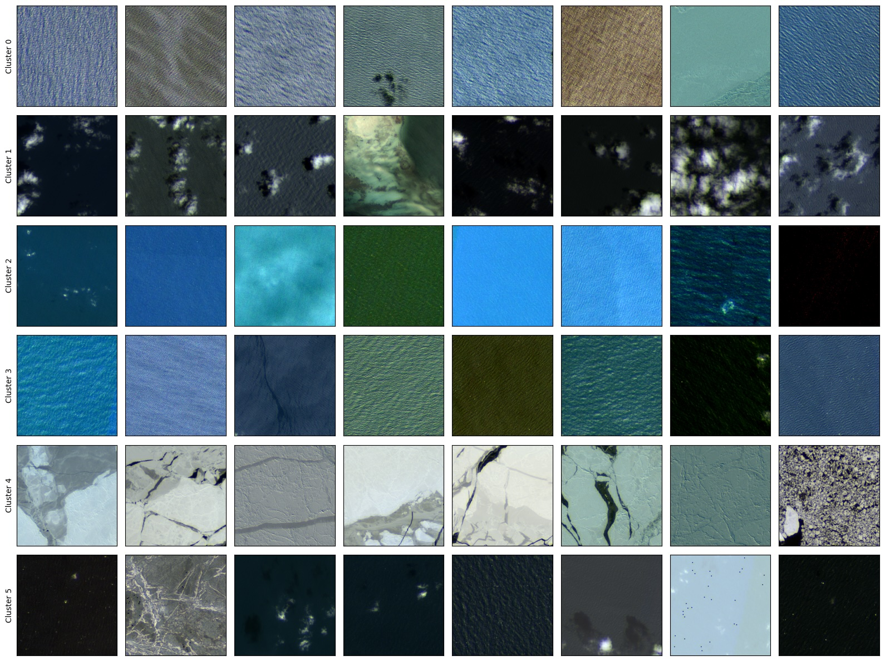

# Hydro -- A Foundation Model for Water in Satellite Imagery

<p align="center">
    <br/>
</p>

This repo started out as mostly /s and is a work in progress side project, but maybe something useful or interesting will happen.

### Motivation

There are many foundation models for remote sensing but nearly all of them focus on imagery of land. The earth is made of ~71% water. **ML 4 Water needs some more love and attention**. Therefore, we perform pretraining on a large-scale dataset of Sentinel-2 imagery containing water bodies for use in downstream applications such as bathmetry and hydrology.

### Progress

We pretrain [DINOv3](https://arxiv.org/abs/2508.10104) ViT-L/16 encoders on the Hydro dataset with the DINO self-distillation objective (student/teacher EMA, multi-crop), initialized from the satellite-pretrained DINOv3-SAT (`sat493m`) weights rather than from scratch. Three variants share one recipe and differ only in input bands:

| variant | bands | notes |
|---|---|---|
| `rgb` | B04, B03, B02 (8-bit quicklooks) | patch embedding used as-is |
| `all` | all 12 L2A bands | patch embedding inflated 3→12; pretrained RGB filters kept on B04/B03/B02, B01 kept for bathymetry |
| `landsat6` | B02, B03, B04, B08, B11, B12 | Landsat OLI band set, for transfer to Landsat / HLS |

The earlier Swin v2 + SimMIM checkpoints (below) are kept as legacy baselines; the SimMIM pretraining code has been removed.

Our pretraining dataset consists of ~106k sampled 256x256 Sentinel-2 L2A patches containing water from around the globe, from the Planetary Computer STAC collection. Bands: (B01, B02, B03, B04, B05, B06, B07, B08, B8A, B09, B11, B12). Patches mix processing baselines, so roughly half carry the +1000 DN `BOA_ADD_OFFSET`; it is detected and removed per patch before normalization (`scripts/compute_hydro_stats.py`, `src/pretrain/stats.py`).

### Dataset Download

The dataset is hosted on HuggingFace and can be downloaded [here](https://huggingface.co/datasets/isaaccorley/Hydro).

### Checkpoints

<table><tbody>
<!-- START TABLE -->
<!-- TABLE HEADER -->
<th valign="bottom">Name</th>
<th valign="bottom"># Channels</th>
<th valign="bottom">Image Size</th>
<th valign="bottom">Config</th>
<th valign="bottom">Checkpoint</th>
<!-- TABLE BODY -->
<!-- ROW: faster_rcnn_R_50_C4_1x -->
 <tr><td align="left">Swin v2 RGB</td>
<td align="center">3</td>
<td align="center">256 x 256</td>
<td align="center"><a href="checkpoints/swin-v2-rgb/config.yaml">config</a></td>
<td align="center"><a href="https://huggingface.co/isaaccorley/hydro-foundation-model/blob/main/swin-v2-rgb/ckpt_epoch_799.pth">model</a>&nbsp;</a></td>

</tr>
<!-- ROW: faster_rcnn_R_50_DC5_1x -->
 <tr><td align="left">Swin v2 MSI</td>
<td align="center">12</td>
<td align="center">256 x 256</td>
<td align="center"><a href="checkpoints/swin-v2-msi/config.yaml">config</a></td>
<td align="center"><a href="https://huggingface.co/isaaccorley/hydro-foundation-model/blob/main/swin-v2-msi/ckpt_epoch_799.pth">model</a>&nbsp;</td>
</tr>
</tbody></table>

### Usage

```bash
pip install -r requirements.txt
```

**Pretraining (DINO).** One entrypoint, pick the band preset; `--root` is the tif directory for MSI presets and the RGB quicklook directory for `rgb`:

```bash
python -m src.pretrain.train --bands rgb      --root /path/to/hydro/data_jpg
python -m src.pretrain.train --bands all      --root /path/to/hydro/data
python -m src.pretrain.train --bands landsat6 --root /path/to/hydro/data
```

The schedule follows Meta's DINOv3 → satellite adaptation reference (FINO, `vitl16_fmow_guided.yaml`): student and teacher both start from DINOv3-SAT; stage 1 keeps the backbone frozen while the fresh DINO head trains (`--freeze-backbone-steps`), stage 2 unfreezes it with a linear LR ramp; constant LR after warmup, layerwise LR decay, reduced patch-embed LR, frozen cls/register tokens, no Gram anchoring. Runs are step-based (`--steps`, default 15k at effective batch 256). Checkpoints (`output/dino/<preset>/`) save `teacher_encoder` (the artifact to keep), the full student, and the exact normalization used (`norm`: stats, bands, clamp, offset convention) so downstream users can't apply the wrong statistics. `scripts/pretrain_dino.sbatch` + `scripts/submit_dino_chain.sh` run the three presets sequentially on one GPU each.

**Legacy Swin v2 checkpoints.** The released SimMIM-pretrained Swin v2 encoders can still be loaded for baselines:

```python
from src.models import swin_v2

model, transforms, config = swin_v2("checkpoints/swin-v2-msi/config.yaml")
```

Some helper methods are provided with the Swin model for different use cases

```python
import torch

# Reset the classifier head to your desired number of classes
model.reset_classifier(num_classes=10)


# Extract image level embeddings
x = torch.randn(1, 12, 256, 256)
x = transforms(x)
model.forward_features(x)  # (1, 1024)

# Extract intermediate feature maps
x = torch.randn(1, 12, 256, 256)
x = transforms(x)
features = model.get_intermediate_layers(x, n=(0, 1, 2, 3, 4), reshape=True)
for i, f in enumerate(features):
    print(i, f.shape)

"""
0 torch.Size([1, 128, 64, 64])
1 torch.Size([1, 256, 32, 32])
2 torch.Size([1, 512, 16, 16])
3 torch.Size([1, 1024, 8, 8])
4 torch.Size([1, 1024, 8, 8])
"""
```

### Evaluation

Dataset and datamodule code is included for MADOS, [MARIDA](https://marine-debris.github.io/), SWED, Earth Surface Water, MagicBathyNet, and Ships-S2-AIS (`src/datasets/`), with hydra configs under `configs/<dataset>/`. `train.py` / `test.py` run a segmentation task from a config:

```bash
python train.py --config configs/swed/hydro_msi.yaml
```

### Cite

If you use our pretrained models in you work please cite the following:

```bash
@misc{Corley:2024,
  Author = {Isaac Corley, Caleb Robinson},
  Title = {Hydro Foundation Model},
  Year = {2024},
  Publisher = {GitHub},
  Journal = {GitHub repository},
  Howpublished = {\url{https://github.com/isaaccorley/hydro-foundation-model}}
}
```
